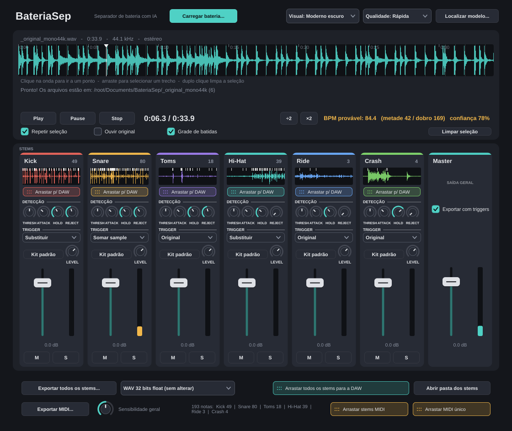
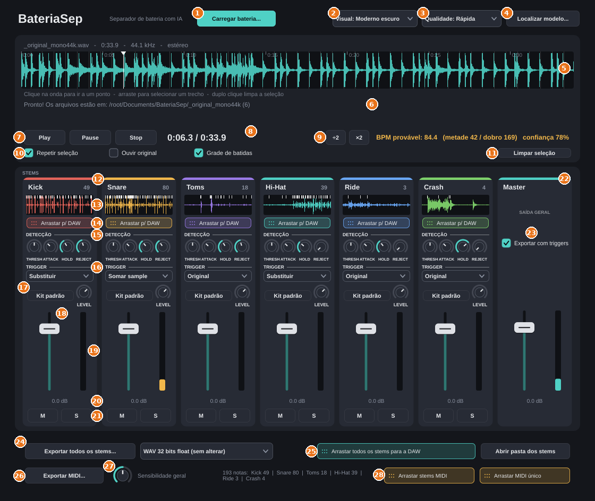
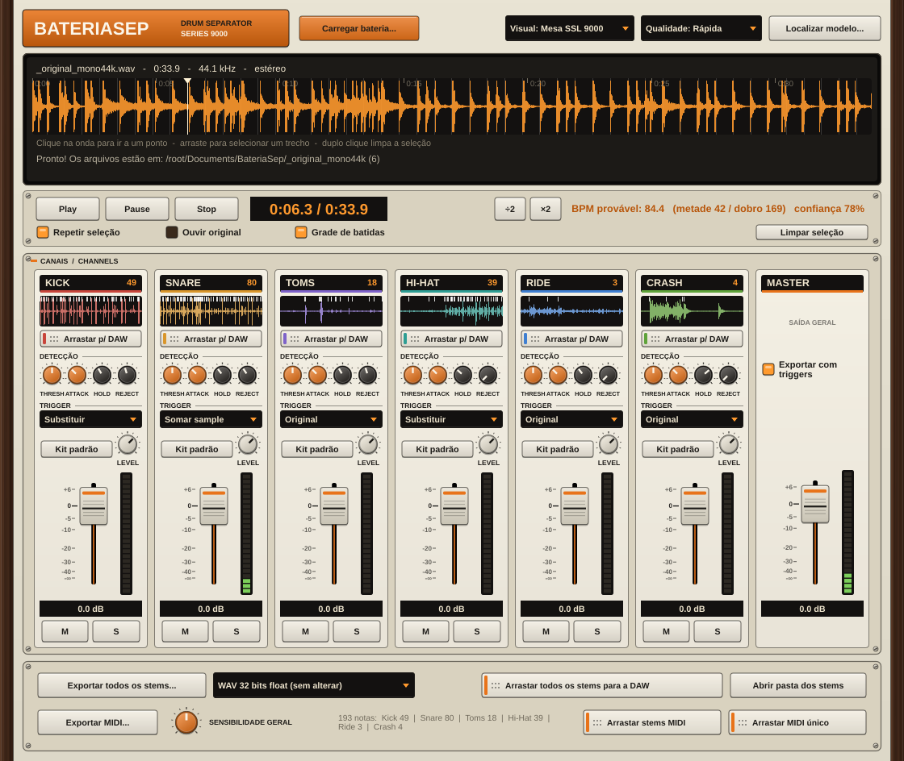
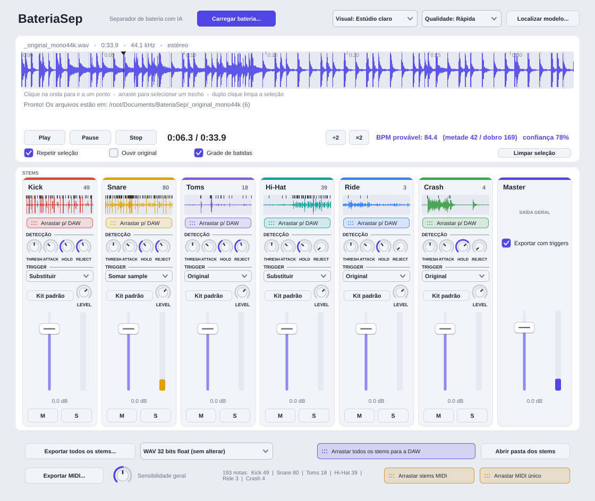

# BateriaSep



**BateriaSep** é um plugin (VST3 e programa independente) que separa uma gravação de bateria — inclusive de **um microfone só** — em 6 peças com inteligência artificial: **Kick, Snare, Toms, Hi-Hat, Ride e Crash**. Roda no seu computador, sem internet e sem placa de vídeo.

Além de separar, ele:

- toca e mixa cada peça (faders, mute, solo), com **3 visuais à escolha** (escuro moderno, mesa SSL 9000 e claro);
- detecta cada golpe e gera **arquivos MIDI com velocity** (a intensidade do baterista);
- permite **somar ou substituir** o som de cada peça por samples (kit padrão incluso, ou os seus), respeitando a dinâmica;
- exporta ou arrasta tudo para a sua DAW.

## Índice

1. [Instalação](#1-instalação)
2. [Primeiros passos](#2-primeiros-passos)
3. [Guia da tela](#3-guia-da-tela)
4. [Ajustando a detecção de golpes](#4-ajustando-a-detecção-de-golpes)
5. [MIDI](#5-midi)
6. [Triggers (somar ou substituir o som)](#6-triggers-somar-ou-substituir-o-som)
7. [Exportar e arrastar para a DAW](#7-exportar-e-arrastar-para-a-daw)
8. [Projeto da DAW e onde ficam os arquivos](#8-projeto-da-daw-e-onde-ficam-os-arquivos)
9. [Problemas comuns](#9-problemas-comuns)
10. [Para quem quer compilar (desenvolvedores)](#10-para-quem-quer-compilar-desenvolvedores)
11. [Licenças e créditos](#11-licenças-e-créditos)

---

## 1. Instalação

Baixe o instalador do seu sistema na aba **Releases** deste repositório e dê dois cliques:

| Sistema | Arquivo | Observação |
|---|---|---|
| Windows | `BateriaSep-Setup.exe` | Se aparecer "O Windows protegeu o computador": **Mais informações → Executar assim mesmo**. |
| Mac (Intel e Apple Silicon) | `BateriaSep-<versão>-mac.pkg` | Se o Mac bloquear: botão direito → **Abrir**, ou Ajustes do Sistema → Privacidade e Segurança → **Abrir mesmo assim**. |
| Linux (Ubuntu/Debian/Mint) | `BateriaSep-<versão>-linux-amd64.deb` | Dois cliques, ou `sudo apt install ./arquivo.deb`. |
| Linux (outras) | `BateriaSep-<versão>-linux.tar.gz` | Extraia e rode `./install.sh`. |

O instalador coloca o plugin, o programa independente e o modelo de IA nos lugares certos. Depois, **reescaneie os plugins VST3 na sua DAW**.

> Os avisos do Windows/Mac aparecem porque o instalador não tem assinatura digital paga. É esperado.

## 2. Primeiros passos

1. Abra a sua DAW, crie uma faixa e insira o **BateriaSep** nela (ou abra o programa independente `BateriaSep`).
   *Na DAW, o motor de áudio precisa estar rodando para o player do plugin tocar. No Reaper, habilite **Options → Run FX when stopped**.*
2. Clique em **Carregar bateria...** (item 1 do guia abaixo) ou **arraste o arquivo de áudio para a janela**. Aceita WAV, AIFF, FLAC, OGG e MP3, com até 8 minutos.
3. Espere a separação (a barra mostra o progresso e o tempo restante). Já dá para ouvir o original enquanto ela roda. Em uma CPU comum, 34 s de áudio levam cerca de 2 min na qualidade *Rápida* e 4 min na *Padrão*; CPUs com mais núcleos são bem mais rápidas.
4. Quando aparecer "Pronto!", use **Play** e mexa nos faders, **M** (mute) e **S** (solo) de cada peça.
5. Confira os **números nas placas dos canais** e as **marcas brancas** nas minitelas: são os golpes detectados. Se estiver detectando errado, ajuste os knobs de **DETECÇÃO** ([seção 4](#4-ajustando-a-detecção-de-golpes)).
6. Exporte os stems, o MIDI ou arraste para a DAW ([seção 7](#7-exportar-e-arrastar-para-a-daw)).

## 3. Guia da tela



### Topo e visor

| # | Controle | O que faz |
|---|---|---|
| 1 | **Carregar bateria...** | Escolhe o arquivo de áudio a separar. Você também pode arrastar o arquivo para a janela. |
| 2 | **Visual** | Troca a aparência do plugin entre os 3 visuais ([veja abaixo](#visuais-skins)). A escolha fica salva para todos os projetos. |
| 3 | **Qualidade** | *Padrão* (mais fiel ao modelo) ou *Rápida* (cerca de 2× mais veloz, um pouco menos de qualidade). Vale para a próxima separação. |
| 4 | **Localizar modelo...** | Só use se o plugin avisar que não achou o modelo de IA (`drumsep_core.onnx`): aponte onde o arquivo está. |
| 5 | **Forma de onda** | Clique para ir a um ponto. **Arraste para selecionar um trecho** (toca só a seleção). Duplo clique limpa a seleção. As linhas verticais claras são a grade de batidas. |
| 6 | **Status / progresso** | Mostra o que o plugin está fazendo, erros e onde os arquivos foram gravados. Durante a separação há um botão **Cancelar** no topo. |

### Player e tempo

| # | Controle | O que faz |
|---|---|---|
| 7 | **Play / Pause / Stop** | Controles do player embutido. |
| 8 | **Visor de tempo** | Posição atual / duração total. |
| 9 | **÷2 / ×2 e BPM** | Mostra o **BPM provável** (com as alternativas metade/dobro e a confiança). Se o plugin escolheu a oitava errada, use **÷2** ou **×2**. O BPM é usado na grade e no tempo dos arquivos MIDI. |
| 10 | **Repetir seleção / Ouvir original / Grade de batidas** | *Repetir seleção*: repete o trecho selecionado. *Ouvir original*: compara (A/B) com a gravação original, sem separar. *Grade de batidas*: mostra/esconde as linhas de batida na onda. |
| 11 | **Limpar seleção** | Remove a seleção e volta a tocar o arquivo inteiro. |

### Cada canal (peça)

Os 6 canais são iguais; o 7º é o **Master**.

| # | Controle | O que faz |
|---|---|---|
| 12 | **Placa do nome** | Nome da peça e, em laranja, **quantos golpes foram detectados** nela. |
| 13 | **Minitela** | Forma de onda da peça. Cada **marca branca no alto** é um golpe detectado (vira nota MIDI e dispara o trigger). Use para conferir a detecção. |
| 14 | **Arrastar p/ DAW** | Arraste este botão para uma faixa da DAW: leva o arquivo de áudio dessa peça. |
| 15 | **DETECÇÃO** (4 knobs) | THRESH, ATTACK, HOLD, REJECT: regulam **quando** um golpe dispara. Veja a [seção 4](#4-ajustando-a-detecção-de-golpes). *Dica: passe o mouse para ver a explicação; duplo clique volta ao padrão.* |
| 16 | **TRIGGER** (modo) | **Original**, **Somar sample** ou **Substituir**. Veja a [seção 6](#6-triggers-somar-ou-substituir-o-som). |
| 17 | **Kit padrão / LEVEL** | O botão escolhe o kit padrão ou importa **seus samples**. O knob **LEVEL** ajusta o volume do sample. |
| 18 | **Fader** | Volume da peça (−∞ a +6 dB). Duplo clique volta a 0 dB. |
| 19 | **Medidor de LEDs** | Nível de saída da peça (vermelho = acima de 0 dB). |
| 20 | **Leitura em dB** | Valor atual do fader. |
| 21 | **M / S** | **M** = mute, **S** = solo. Com algum solo ligado, só as peças em solo tocam. |
| 22 | **Master** | Volume geral de saída. |
| 23 | **Exportar com triggers** | Ligado: os arquivos exportados/arrastados usam o som dos triggers (veja a [seção 6](#6-triggers-somar-ou-substituir-o-som)). |

### Base (exportação)

| # | Controle | O que faz |
|---|---|---|
| 24 | **Exportar todos os stems...** + formato | Grava os 6 arquivos numa pasta à sua escolha. Formato: WAV 32 bits float (sem alterar) ou WAV 24 bits (com o mesmo ganho de segurança em todos, para não estourar). |
| 25 | **Arrastar todos os stems para a DAW** / **Abrir pasta dos stems** | Arrasta os 6 arquivos de uma vez para a DAW. O outro botão abre a pasta onde eles estão. |
| 26 | **Exportar MIDI...** | Grava os arquivos `.mid` (um por peça e um com todas) numa pasta à sua escolha. |
| 27 | **Sensibilidade geral** | Quantas notas o MIDI/trigger aceita, para todas as peças ao mesmo tempo. Veja a [seção 4](#4-ajustando-a-detecção-de-golpes). |
| 28 | **Arrastar stems MIDI / Arrastar MIDI único** | Levam para a DAW os 6 arquivos `.mid` (um por peça) ou o arquivo único com todas as peças. |

### Visuais (skins)

No menu **Visual** (item 2) você escolhe entre 3 aparências. Todas têm os mesmos controles e funcionam igual; muda só o desenho. A escolha fica salva e vale para todos os projetos e instâncias do plugin.

| Moderno escuro (padrão) | Mesa SSL 9000 | Estúdio claro |
|---|---|---|
|  |  |  |
| Visual limpo e escuro, com destaque em verde-água. | Console analógico inspirado nas SSL 9000: off-white e laranja, knobs e faders de mesa, LEDs e laterais de madeira. | Visual claro e minimalista, com destaque em índigo. |

## 4. Ajustando a detecção de golpes

O plugin acha os golpes de cada peça procurando **subidas bruscas de volume**. Como a separação por IA nunca é perfeita, às vezes ele dispara onde não deveria (vazamento de outra peça, ressonância, cauda) ou perde golpes fracos. Cada canal tem 4 knobs para regular isso, e a **Sensibilidade geral** (item 27) regula todas as peças de uma vez.

**Como ajustar:** gire um knob e espere cerca de 1 segundo — a minitela, o contador da placa do nome e os arquivos MIDI são refeitos. Procure marcas brancas **só onde há golpe de verdade**.

| Knob | Faixa | O que faz | Gire para a direita (→) quando… | Gire para a esquerda (←) quando… |
|---|---|---|---|---|
| **THRESH** (threshold) | −18 a +18 dB | Nível mínimo para um golpe contar, em relação aos golpes mais fortes da peça | dispara em sons fracos, vazamento ou barulho de fundo | está perdendo golpes fracos (ghost notes) |
| **ATTACK** | −6 a +12 dB | Quão **brusca** precisa ser a subida do som | dispara em ressonância ou vazamento (sons que sobem devagar) | está perdendo golpes de ataque suave |
| **HOLD** | 10 a 400 ms | Intervalo mínimo entre dois golpes da mesma peça | um golpe dispara **duas vezes** (duplo disparo) | faltam notas muito rápidas (rulos, flams) |
| **REJECT** (rejeição de cauda) | 0 a 80 % | Descarta golpes fracos que vêm logo depois de um golpe forte (a "cauda" da própria peça). 0 desliga | dispara na ressonância do bumbo/caixa/tom/prato | está descartando golpes fracos verdadeiros |

Valores padrão de HOLD: Kick 40 ms, Snare 35, Toms 40, Hi-Hat 28, Ride 35, Crash 150. Padrão de REJECT: Kick 35 %, Snare 30 %, Toms 35 %, demais 0 %. **Duplo clique** em um knob volta ao padrão.

### Receitas rápidas

| Sintoma | O que fazer |
|---|---|
| Hi-hat/ride/crash "tocando" junto com a caixa ou o bumbo (vazamento) | Na peça errada: **THRESH →** e/ou **ATTACK →**. |
| Falta ghost note na caixa | **THRESH ←** (e se precisar **ATTACK ←**). |
| Uma nota aparece duas vezes por golpe | **HOLD →** (ou **REJECT →**). |
| Rulo de caixa/tons está com notas faltando | **HOLD ←** e **REJECT ←**. |
| Dispara quando o bumbo ou a caixa "ressoa" depois do golpe | **REJECT →** e **ATTACK →**. |
| Tudo disparando demais, em todas as peças | **Sensibilidade geral ←**. |
| Peça que nem foi tocada aparece com notas | **THRESH →** nessa peça. |

> As regulagens são salvas junto com o projeto da DAW.

## 5. MIDI

Depois da separação, o plugin gera arquivos `.mid` a partir do áudio de cada peça (pasta `MIDI` ao lado dos stems):

- Um arquivo por peça (Kick, Snare, Toms, Hi-Hat, Ride, Crash) e um arquivo único com todas.
- **Mapa General MIDI, canal 10:** kick 36, caixa 38, hi-hat fechado 42 / aberto 46, ride 51, crash 49, toms 43 / 47 / 50 (grave / médio / agudo, pela altura de cada golpe).
- **Velocity 1–127** pela intensidade de cada ataque, relativa aos golpes mais fortes da própria peça.
- O tempo do arquivo é o **BPM mostrado no plugin** (respeita ÷2 / ×2), então as notas caem no mesmo instante do áudio.
- Os ajustes de detecção da [seção 4](#4-ajustando-a-detecção-de-golpes) valem para o MIDI.
- **Arrastar stems MIDI** leva os 6 arquivos para a DAW; **Arrastar MIDI único** leva o arquivo completo. **Exportar MIDI...** grava numa pasta à escolha.

## 6. Triggers (somar ou substituir o som)

Se você não gosta do som de alguma peça gravada, pode trocá-la ou reforçá-la com samples. Em cada canal há um seletor:

- **Original** – só o som gravado (padrão).
- **Somar sample** – o sample toca junto com o som gravado.
- **Substituir** – o som gravado daquela peça é silenciado e só o sample toca.

Os samples tocam exatamente nos golpes detectados (os mesmos do MIDI) e **respeitam a intensidade**: a velocity de cada golpe escolhe a camada do sample (suave → forte, com mistura entre camadas) e ajusta o volume. Há variações alternadas (round-robin), para não soar "metralhadora", e o hi-hat fechado corta o aberto, como numa bateria de verdade.

- **Kit padrão:** Big Rusty Drums (Karoryfer Samples, domínio público CC0), 4 camadas de intensidade × 2 variações por peça, já embutido no plugin.
- **Seus samples:** botão "Kit padrão" do canal → **Importar meus samples...**. *Um arquivo = uma intensidade.* Com vários arquivos, a ordem do nome define do mais suave ao mais forte (`caixa_1.wav`, `caixa_2.wav`, ...). Com um arquivo só, o volume acompanha a intensidade de cada golpe. Aceita WAV, AIFF, FLAC, OGG e MP3 (até 20 s cada). Para voltar ao kit padrão, use o mesmo botão.
- **LEVEL:** volume do sample (−24 a +12 dB).
- **Onde toca:** no player do plugin. No áudio exportado/arrastado só entra se **Exportar com triggers** (no Master) estiver ligado; os arquivos com triggers ficam na pasta `Triggers`, dentro da pasta dos stems, e as peças em *Original* saem iguais ao stem.
- Se um trigger estiver disparando errado, **o problema é a detecção**: ajuste os knobs da [seção 4](#4-ajustando-a-detecção-de-golpes) olhando as marcas da minitela.

## 7. Exportar e arrastar para a DAW

- **Arrastar p/ DAW** (por peça) e **Arrastar todos os stems para a DAW**: os arquivos são gravados automaticamente em `Documentos\BateriaSep\<nome do arquivo>\`, prontos para arrastar. Com **Exportar com triggers** ligado, as peças em Somar/Substituir saem da pasta `Triggers`.
- **Exportar todos os stems...**: grava os 6 WAV numa pasta que você escolher (32 bits float sem alterar, ou 24 bits com o mesmo ganho de segurança em todos).
- **MIDI**: veja a [seção 5](#5-midi).

## 8. Projeto da DAW e onde ficam os arquivos

- Ao reabrir o projeto da DAW, o plugin recarrega os stems da pasta (sem separar de novo) e restaura faders, mute/solo, ajustes de detecção, modos de trigger e os samples que você importou.
- Pasta do projeto: `Documentos\BateriaSep\<nome do arquivo>\` — contém os 6 stems, a pasta `MIDI` e (se usar) a pasta `Triggers`. **Não apague** essa pasta se quiser reabrir o projeto sem separar de novo.
- O modelo de IA fica em `C:\Program Files\BateriaSep` (Windows), `/Library/Application Support/BateriaSep` (Mac) ou `/opt/BateriaSep` (Linux).

## 9. Problemas comuns

| Problema | Solução |
|---|---|
| "Não encontrei o modelo..." | Use **Localizar modelo...** e aponte `drumsep_core.onnx`, ou reinstale com o instalador. |
| "Não consegui carregar bateriasep_onnxruntime.dll (erro 126)" | Instale o *Microsoft Visual C++ Redistributable 2015-2022 (x64)*. |
| O player não toca na DAW | Deixe o motor de áudio rodando (Reaper: *Options → Run FX when stopped*). |
| Separação lenta | Use a qualidade **Rápida**. Depende do número de núcleos da CPU. |
| O BPM veio na metade/dobro | Use **÷2** / **×2**. |
| Notas erradas no MIDI/trigger | Ajuste a detecção ([seção 4](#4-ajustando-a-detecção-de-golpes)). |
| O arquivo é longo demais | O limite é 8 minutos por arquivo. |

## 10. Para quem quer compilar (desenvolvedores)

**Instaladores automáticos.** O workflow `.github/workflows/build.yml` (aba **Actions → Instalador BateriaSep → Run workflow**) converte o modelo, compila e publica na aba **Releases**: `BateriaSep-Setup.exe` (Windows, Inno Setup), `.pkg` (Mac, Intel + Apple Silicon) e `.deb`/`.tar.gz` (Linux). Os scripts ficam em `installer/`. Suba **todo o conteúdo** do projeto ao repositório (inclusive `assets/`, que tem o kit de samples).

**Compilação local (CMake + JUCE 8):**

```
cmake -S . -B build -DCMAKE_BUILD_TYPE=Release -DONNXRUNTIME_ROOT=/caminho/onnxruntime
cmake --build build --target BateriaSep_VST3 BateriaSep_Standalone
```

O modelo ONNX é gerado com `tools/export_onnx.py` a partir dos pesos do DrumSep. O kit padrão de triggers é gerado por `tools/make_kit.py`.

**Testes**

- `tests/test_separator.cpp`: STFT/ISTFT/reamostrador contra o PyTorch e separação completa contra o Python (120 dB de precisão).
- `tests/test_bpm.cpp`: detector de BPM em sinais sintéticos e nas peças reais.
- `tests/test_midi.cpp`: extração de MIDI e ajustes de detecção em baterias sintéticas (`g++ -std=c++17 -O2 tests/test_midi.cpp -o test_midi && ./test_midi`).
- `tests/test_trigger.cpp`: motor de triggers (posição exata, dinâmica, seek, loop, round-robin, choke).
- `tests/test_plugin.cpp`: integração do plugin com áudio real (carregar, separar, tocar, mute/solo, seleção, exportar, MIDI, triggers, reabrir). Compile com `-DBATERIASEP_BUILD_TESTS=ON`.

## 11. Licenças e créditos

- **Modelo DrumSep (aufr33 / jarredou):** os pesos não têm licença publicada. Trate como **uso pessoal / não comercial**. Não distribua o plugin com o modelo dentro nem venda sem confirmar com os autores.
- **Kit de samples:** Big Rusty Drums, Karoryfer Samples, domínio público (CC0). Veja `assets/KIT-CREDITS.txt`.
- Código do modelo (`tools/mdx23c`): MIT (veja `tools/mdx23c/LICENSE-mdxnet-infer`).
- ONNX Runtime: MIT. JUCE: AGPLv3 ou licença comercial (uso pessoal sem problema; para distribuir/vender, respeite a licença).
- O visual é inspirado em consoles analógicos; "SSL" é marca de seus donos e este projeto não tem ligação com eles.
